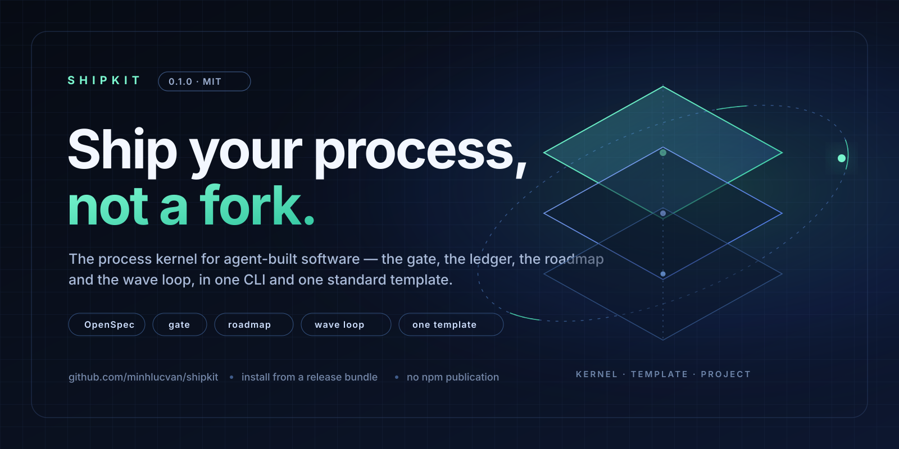

<div align="center">
  
</div>

<h1 align="center">ShipKit</h1>

<p align="center">
  <strong>The process kernel for agent-built software.</strong><br>
  One CLI. One standard template. The gate, the ledger, the roadmap and the wave loop —
  installed into your project, not forked from someone else's.
</p>

<p align="center">
  
  
  
  
  
</p>

---

## Why ShipKit

Agent-built projects keep relearning the same process in every repository: a change proposal, a failing check before
the code, a gate no one can skip, a ledger that remembers what shipped, a roadmap that says what is next. ShipKit takes
those parts out of any one project and ships them as packages.

A project that installs ShipKit gets the process **beside its code**, not in a fork of someone's monorepo.

## What you get

| Piece | What it gives you |
|---|---|
| **`@shipkit/contracts`** | the config, the template manifest and the ports every other piece couples through |
| **`@shipkit/kernel-core`** | the tree reader, the check contract, the report printers |
| **`@shipkit/kernel-checks`** | the framework checks and the runner that prints what each one does **not** prove |
| **`@shipkit/kernel-tracker`** | the roadmap engine: milestones, ranked items, the wave and the run record |
| **`@shipkit/kernel-widgets`** | the widget vocabulary the agent generators read |
| **`@shipkit/registry`** | a template registry over a packed tarball, with a sha256 manifest verified at fetch |
| **`@shipkit/cli`** | `init`, `attach`, `doctor`, `upgrade`, `plan`, `next`, `verify`, `check`, `run`, `method`, `preset` |
| **`shipkit-tpl-mono-repo-std`** | the standard pnpm + turbo monorepo: the process, the scaffold, no product code |

## Install it

ShipKit is **not on npm yet**. A release is one tarball: the kernel packages, the template, the installer and the docs.

```bash
mkdir -p ~/shipkit && cd ~/shipkit
gh release download shipkit-v0.2.0 -p 'shipkit-0.2.0-bundle.tar.gz'
shasum -a 256 -c shipkit-0.2.0-bundle.tar.gz.sha256
tar xzf shipkit-0.2.0-bundle.tar.gz

bash shipkit-0.2.0/install.sh ~/projects/acme \
  --set projectName="Acme" --set projectSlug=acme

cd ~/projects/acme
pnpm install
./shipkit doctor      # config, record, kernel, paths
./shipkit verify      # the project's own gate, step by step
```

No registry account and no `npm publish` are involved. The installer puts the local tarballs into a toolchain under
`~/.local/share/shipkit`, renders the standard template and writes a `./shipkit` launcher.

> The 0.2.0 release is prepared as a **draft**. Publish it from the
> [Releases page](https://github.com/minhlucvan/shipkit/releases) to make the download live.
> Full instructions: [INSTALL.md](INSTALL.md) · ten-minute path: [QUICKSTART.md](QUICKSTART.md).

## The loop

A change moves through the same seven steps in every project:

| # | Step | Command | What it proves |
|---|---|---|---|
| 1 | **Plan** | `./shipkit plan` · `./shipkit next` | the next eligible item is chosen from the ledger, not from memory |
| 2 | **Propose** | `pnpm openspec new change <id> --schema feature` | the change exists before the code does |
| 3 | **Red** | `pnpm test` (the new check fails) | the check can fail for the reason the change claims |
| 4 | **Green** | `pnpm test` (the new check passes) | the implementation answers that check |
| 5 | **Verify** | `./shipkit verify` · `pnpm verify` | the whole gate agrees on the integrated tree |
| 6 | **Archive** | `pnpm openspec archive <id>` | the spec delta is applied and the change is retired |
| 7 | **Record** | `./shipkit doctor` · `pnpm build:tracker` | the project's record and ledger agree with the code |

The verification file pastes a real red run and a real green run. A killed run is unrun — the loop does not accept a
memory of a test.

## Sessions

ShipKit projects are shipped by sessions, not by one prompt. A session takes one roadmap item, carries it through the
loop and leaves the tree green. If your harness has a goal command, set the session's objective before the first turn
so every later turn works the same one.

In an interactive **DeepSeek Harness** session that is `/goal`:

```text
/goal ship M0-3: the first slice, its gate, and its archived change
```

| Command | What it does |
|---|---|
| `/goal` | the current objective, durable phase, round count and the next valid command |
| `/goal <objective>` | creates and arms the session goal, or replaces a completed one |
| `/goal edit <objective>` | changes the objective without changing the phase or activation |
| `/goal pause` / `/goal resume` | pauses an active goal, or re-arms a stopped one |
| `/goal clear` | clears the goal while keeping its durable history |

The command belongs to the harness, not to ShipKit: headless runs do not need it, and another harness may persist the
objective differently. What ShipKit adds is the answer to **what** the goal should be — `./shipkit plan` and
`./shipkit next` read it from the project's ledger, not from the session's memory. A session's goal and the project's
roadmap are two records: the goal keeps the run pointed at one outcome, the roadmap keeps the project's next item.

## The CLI

```text
shipkit doctor   what the project is: config, template record, kernel, every declared path
shipkit plan     the next eligible roadmap item
shipkit next     the same answer for a script
shipkit verify   the project's gate steps, one by one, with the command that ran
shipkit check    the project's own check list
shipkit init     render the standard template into an empty directory
shipkit attach   add the kit to an existing project
shipkit upgrade  regenerate the template's shared files; dry run first
shipkit run      a session over the brief with an agent driver
shipkit method   the workflow method a project declares
shipkit preset   apply a project preset
```

Every job reads the same `shipkit.config.yml`. Paths, packages, gate steps and drivers are project data, not kernel
assumptions.

## The template

`shipkit-tpl-mono-repo-std` renders a workspace where the process is as real as the code:

- **The gate** — `pnpm verify` runs lint, typecheck, check, test, specs and e2e generation.
- **The ledger** — a seeded roadmap with milestones, ranked `rm-*` items and a tracker that names what is next.
- **The loop** — OpenSpec with a worked example change: proposal, flows, spec delta, tasks, verification, archive.
- **The rules** — `AGENTS.md` and `CONTEXT.md` for a session; skills under `.agents/skills/`, linked for Claude Code.
- **The product vault** — `docs/product/` for features, stories, rules and decisions.
- **The e2e scaffold** — Gherkin features and Playwright config, ready for the first journey.
- **No product code** — empty `feature-*` and `domain-*` seeds mark where the product goes.

Every shared file is classified by the template. `upgrade` regenerates the shared ones and leaves everything else
alone; a file the classification does not name is excluded, never shared.

## Agents

ShipKit is built for sessions that write software:

- the **DeepSeek Harness** driver runs a brief against a project with recorded fixtures for every test;
- the **Claude Code** driver is the local default;
- `shipkit run` is the loop entry point; `shipkit method` names the workflow a project declares.

Nothing calls a vendor by default. A live model turn is a manual run with a credential you supply — and the docs say so
instead of implying otherwise.

## What it does not prove

A green gate is a shape check, not a product review. Read this before adopting it:

- **A check proves the shape, not the product.** Every check prints what it does not prove; a green run says the files
  are where the rules expect them, not that the software is right.
- **The template proves a project generates and its own gate passes** — not that the generated project is a good
  project, that the scaffold is complete for your answers, or that the roadmap it seeds is your roadmap.
- **The upgrade does not merge your edits.** It regenerates classified `shared` files; everything else stays yours.
- **The loop is deterministic but not omniscient.** Selection, retries, gates and completion are code; whether the work
  a session did is good is a review, not a check.
- **Installing proves the artifact is well-formed**, not that the kit fits your project.

## Status

- **0.2.0** — the bundle release; prepared as a draft on the [Releases page](https://github.com/minhlucvan/shipkit/releases).
- **No npm publication.** The kernel and template install from the bundle's local tarballs.
- **Source extraction pending.** This repository is the distribution home; the source is still built and tested in the
  ShipIt repository, and the same extraction moves the source, the checks and the release workflow here.

## Docs

| File | What it is |
|---|---|
| [INSTALL.md](INSTALL.md) | installing from the bundle, existing projects, upgrade, uninstall, troubleshooting |
| [QUICKSTART.md](QUICKSTART.md) | a project and its first shipped change in about ten minutes |
| [UPGRADE.md](UPGRADE.md) | the version policy and how a project learns it is behind |
| [RELEASE.md](RELEASE.md) | how a release is built, verified and published here |
| [CHANGELOG.md](CHANGELOG.md) | what each release carries |
| [CONTRIBUTING.md](CONTRIBUTING.md) | contribution rules and where the source lives today |
| [SECURITY.md](SECURITY.md) | reporting a vulnerability privately |

## Contributing and licence

The source is being extracted; until it lands, code changes are reviewed in the ShipIt repository and this repository
carries the docs, the releases and the installation reports. See [CONTRIBUTING.md](CONTRIBUTING.md).

MIT — see [LICENSE](LICENSE).
